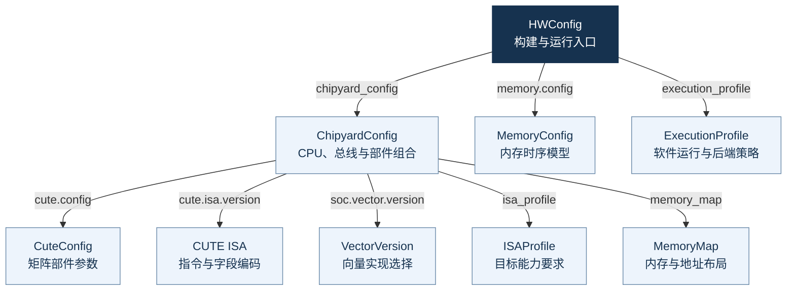
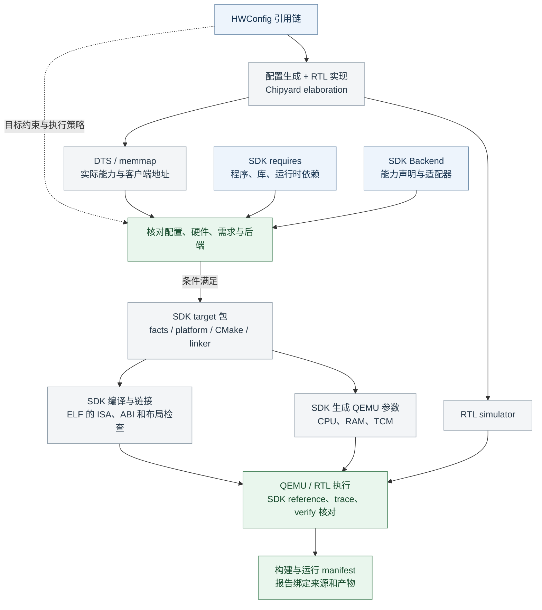

# Config-first：对象、依赖与唯一事实来源

假设我们已经决定：“先用单核 Shuttle，配上 Saturn 和 CUTE，把一个模型阶段跑对。”
接下来不应该再让硬件、SDK 和 QEMU 各自猜一遍这些选择。我们需要把决定写到明确的
位置，让各个工具和 agent 都能沿着它继续工作。

OpenCUTE 用 **HWConfig 作为一次系统构建的入口**。它找到硬件组合、内存模型和运行
策略；硬件组合再找到具体部件与能力要求。这样，从一个入口就能追到本次系统的选择。

这一章先看配置引用关系，再沿一次构建说明：输入哪些数据，经过什么处理和检查，
产物保存在哪里，下一步可以拿它做什么。这样，每次交接都有明确的依据。

## 1. 谁引用谁 {#dependencies}

下面每条箭头表示**引用方 → 被引用对象**，箭头旁是 YAML 中的字段。
这些是输入依赖，不表示代码执行顺序。

读图时，可以先把 HWConfig 理解成本次构建的选择单，把 ChipyardConfig 理解成硬件
组合单。其他对象分别保存它们引用的一类决定，而不是把同一套参数再抄一份。

有些决定直接写在对象内部：`simulator` 就在 HWConfig 中，CPU、核数、总线和缓存
参数在 ChipyardConfig 中。当前没有独立的 SimulatorPolicy 文件夹。
需要独立维护和复用的一组选择，再拆成自己的文件。

| 对象与维护位置 | 负责回答什么 | 主要消费者 |
|---|---|---|
| HWConfig：`configs/hwconfigs/` | 本次选哪套硬件、内存模型和执行策略？ | 构建器与 runner |
| ChipyardConfig：`configs/chipyard_configs/` | 哪种 CPU、多少核，怎样连接 CUTE、RVV、总线和缓存？ | Chipyard 配置生成器 |
| CuteConfig：`configs/cute_configs/` | 矩阵部件内部采用哪些阵列、缓冲和执行参数？ | CUTE 参数与 Scala 生成器 |
| CUTE ISA：`configs/cute_isa_versions/` | 指令、字段、datatype 的编码是什么？ | Scala 常量、SDK 指令头；RTL/QEMU 按定义实现语义 |
| VectorVersion：`configs/vector_versions/` | 选用哪个向量实现，其来源与能力声明是什么？ | 配置检查及生成工具；具体 VLEN 等参数仍在 ChipyardConfig |
| ISAProfile：`configs/isa_profiles/` | 目标必须满足哪些标准 ISA、版本、精确向量参数与自定义契约？ | 实际硬件能力检查器 |
| MemoryMap：`configs/memory_maps/` | 期望有哪些内存和设备地址区域，容量、属性与可见范围是什么？ | RAM/ROM/MMIO 与私有 TCM 的布局生成、导出核对及 SDK 地址视图 |
| MemoryConfig：`configs/memconfigs/` | DRAMSim 等内存模型使用哪些时序参数？ | 仿真内存模型；由 `memory.model` 与 `memory.config` 一起选择 |
| ExecutionProfile：`configs/execution_profiles/` | ABI、启动/I/O、堆栈预算和 QEMU 覆盖要求是什么？ | SDK 目标包与后端适配器 |

文件里写了一个值以后，还需要工具知道它是否合理。`configs/schemas/` 检查字段、
类型和范围，`chipyard_config_params.json` 维护部分默认值与 Scala mixin 映射。
还有一些未显式配置的部件参数使用实现默认值，所以同一个 CONFIG 也要配合确定的
实现版本。给 capability 加一个名称，只是写下了声明，仍需相应的实现和检查。

### MemoryMap 覆盖整个地址空间 {#memory-map}

MemoryMap 说明这套 SoC **预期有哪些存储和设备地址区域**。私有 TCM 只是其中
一部分；普通 RAM 的容量和地址、启动 ROM、保留区，以及外设的 MMIO 地址范围，
也需要有明确的配置归属。

例如，“有 2 GiB 主存”还不完整：它从哪个地址开始，哪些区域留给程序，哪些是保留区，
哪些地址实际访问的是设备寄存器，都影响程序怎样链接和运行。对私有内存，还要说明
属于哪个核、哪些访问方可见；对设备，还需要知道设备类型，后端才能判断是否支持。

| 应描述的区域 | 需要表达的选择 | 当前实现情况 |
|---|---|---|
| RAM | 预期基址、容量、访问属性与可见范围 | v2 已声明并核对；外部 RAM 基址、容量可驱动硬件生成 |
| ROM 与保留区 | 地址范围、用途，以及哪些空间不能分配给程序 | BootROM 布局可配置；静态保留区进入 DTS，并从 SDK 分配中扣除 |
| 外设 MMIO | 设备标识、寄存器窗口基址与长度、访问范围 | v2 已核对设备地址、类型和权限；已有硬件绑定可修改相应窗口，其余窗口按固定约束检查 |
| 私有 TCM | 容量、内部基址、bank 数、所属核与客户端视图 | 已配置布局和所属核，实际客户端窗口由硬件导出后核对 |

当前 MemoryMap v2 包含 `regions`、`reserved` 和 `tcm`；内置完整平台使用
`coverage: complete`，漏掉导出的全局区域也会报错。旧 v1 TCM 配置保留兼容。
地址区域也需要分清 RAM 和 MMIO：设备寄存器不能因为有地址范围就被当作普通工作内存。

当前链路为：**MemoryMap 声明预期 → 硬件配置落实布局 →
DTS 导出实际结果 → 核对预期 → 生成 SDK 地址视图并检查后端支持**。
可配置的地址传给硬件；实现固定的地址作为约束核对。区域重叠、容量不符、设备缺失或
私有归属不符时，给出明确诊断。MemoryConfig 继续负责内存仿真的时序参数。
具体字段、硬件绑定、生成头文件和后端范围见 [MemoryMap 地址空间](memory-map.md)。

## 2. 输入怎样变成下一步可用的产物 {#flow}

这张图展示数据沿构建与验证流程的流动。每到一个交接点，先检查输入和产物能否对上，
再把它交给下一环节。

这里最重要的交付物有三个：**`target/` 说明目标是什么，`build-manifest.json` 指明
有哪些匹配的可执行产物，运行目录保存这次实验的结果和依据。** 它们各自从前一步
生成，并带着来源进入下一步。

### 配置和实现源码，先生成硬件与导出描述

输入是 HWConfig 引用的配置、对应的部件实现，以及已有工具环境。构建器先检查
配置结构、引用和生成代码是否一致，再通过 Chipyard 展开硬件，产生 SystemVerilog、
DTS 和内存导出。

这一步把“我们选了什么”落实成“实际生成了什么”。SystemVerilog 交给后续 RTL
编译；DTS 和内存导出交给目标检查器，让软件侧知道实际指令能力、内存和设备地址。
只有硬件展开成功，才继续生成对应的 SDK 目标包。

### 硬件导出加上软件需求，生成 target 目标包

接着输入同次 DTS、内存导出、SDK 程序及依赖的 requires、ExecutionProfile 和后端
能力。检查器核对硬件是否满足配置中已实现的约束、软件需要的指令和内存是否存在，
以及所选 QEMU 后端能否支持本次执行。

匹配通过后，生成 `target/`：

- `facts.json` 整理硬件实际导出的能力与地址信息，`requires.json` 保存归并的软件需求。
- `platform.json` 给出本次执行使用的平台参数；SDK 的 QEMU 适配器据此设置 ISA 模拟器。
- `target.cmake` 和 `target.ld` 把编译选项、链接地址及堆栈预算交给 SDK 构建。
- `bundle.json` 记录输入与生成文件的身份，后续消费前再次核对。
- `memory-map.json` 和 `target_memory.h` 交付已核对的地址区域及软件使用的地址常量。

目标包通过条件匹配，表示可以继续构建这段软件；此时还没有运行程序，也没有产生
正确性结论。RAM/ROM/MMIO 的地址声明通过核对，也不意味着后端已经实现任意设备行为；
软件要求访问的设备仍须通过后端覆盖检查。

### 目标包和源码，编译出程序与工具，再形成构建清单

SDK 消费目标包编译、链接程序，构建器编译 QEMU ISA 模拟器和 verifier，硬件工具
把 SystemVerilog 编译为 RTL simulator。随后检查 ELF 的 ISA、ABI 和内存布局，
并运行 QEMU 指令与平台边界探针。

构建全部完成、来源核对一致后，写出 **`build-manifest.json`**。它列出 simulator、
QEMU、verifier、ELF、case、输入数据和目标包的路径与身份，是运行器查找匹配产物的
入口。仅看到某个 simulator 文件还不够，清单让它能和对应的软件、配置一起使用。

### 构建清单和 case，生成一份完整运行记录

运行器读取构建清单和选定的 case，先核对源码、工具、目标包、输入及 ELF。
QEMU 执行程序、导出任务输出；独立 reference 校准这些输出后，才把它们作为 golden
交给后续验证。RTL 执行保存 trace，verifier 根据初态、golden 和 trace 检查真实结果。

运行目录保存 `target/` 副本、构建与运行清单、golden、trace 和报告。只有数值、协议
及完成条件都满足，才产生 PASS；在线运行还要与独立离线报告一致。
如果只停在 golden 或 trace 阶段，得到的是阶段就绪记录，继续验证的入口见
[分步实验](demo/index.md)。

### Only One Truth：每次交接都能追到来源 {#single-truth}

**一件已经敲定的事，只维护一份定义，其他地方引用或生成。** CONFIG 保存系统选择，
DTS 导出实际能力，requires 描述软件需求；下游通过检查后使用对应产物。比如调整
TCM 容量，应修改 MemoryMap 并重新生成，避免再手改 SDK 地址或 QEMU 参数。

| 关键交付物 | 通过哪些检查后使用 | 交给谁、用于什么 |
|---|---|---|
| `target/` | 配置与实际导出核对、软件需求和后端能力匹配；使用前核对 bundle 身份 | SDK 编译链接，QEMU 参数生成，runner 读取目标信息 |
| `build-manifest.json` 及它引用的产物 | 完整构建、ELF 与 QEMU 契约检查、源码和产物身份检查 | runner 执行已登记的 case；模型构建器检查后复用硬件/QEMU |
| 运行目录 | 运行前的身份检查，golden 校准，RTL 执行及对应验证 | 人或 agent 判断本次结果；离线回放器复核保存的 trace |

配置选择、实际导出、运行结果分别保存在相应产物里，沿清单可以追查它们怎样形成。
身份相符说明使用的是同一组内容；是否计算正确，仍由独立 reference 和运行检查回答。

### 一次增量怎样接回这条链路 {#task-brief}

交给 agent 前，写清**目标、HWConfig 与源码基线、修改范围、前置依赖、验收方法及预算**。
例如“调整这套目标的 TCM 容量，并让原用例继续通过”，就能沿配置找到部件和消费者。
接口已固定的部分可以并行，共享定义由明确的任务维护。

改动从所属配置或实现开始，重新生成受影响的产物，再跑约定的检查。完成后交出新清单、
报告和复现入口，保留限制与未完成项；局部任务通过后，再由父任务检查组合结果。
这样，下一次开发就能从这次已经确认的结果继续。

## 3. 关键产物保存在哪里 {#artifacts}

下面对应 [构建章节](build-system.md) 使用的相对路径。点击目录可以展开，图中的
“指纹”和“本次运行”表示工具生成的目录名，不需要手工拼写。这里只列主要产物；
运行部分展示完整在线验证结束后的内容。

<nav class="repo-tree" aria-label="OpenCUTE 构建与运行产物目录">

<strong>../opencute-out/</strong>从仓库根目录向外保存产物

<ul class="repo-tree-list">
<li>

<code>system/</code>一次系统构建
<ul>
<li>
<code>build-manifest.json</code>运行与复用的总入口 <a class="repo-tree-jump" href="#use-build">用途 →</a>
</li>
<li>

<code>target/</code>SDK 目标包
<ul>
<li>
<code>hardware.dts</code>本次硬件导出
</li>
<li>
<code>hardware.memmap.json</code>系统可见内存导出
</li>
<li>
<code>facts.json</code>整理后的实际能力与地址
</li>
<li>
<code>requires.json</code>归并后的软件需求
</li>
<li>
<code>platform.json</code>本次执行的平台参数
</li>
<li>
<code>memory-map.json</code>已核对的全局区域、保留区与私有视图
</li>
<li>
<code>target_memory.h</code>软件使用的区域地址常量
</li>
<li>
<code>target.cmake</code>SDK 编译与链接选项
</li>
<li>
<code>target.ld</code>程序、堆、栈的内存布局
</li>
<li>
<code>bundle.json</code>目标包来源和文件哈希
</li>
</ul>
</li>
<li>

<code>build/</code>实际程序与工具
<ul>
<li>

<code>rtl-〈指纹〉/</code>按硬件与工具身份区分
<ul>
<li>
<code>generated-src/</code>SystemVerilog 及硬件导出
</li>
<li>
<code>simulator-system</code>RTL simulator
</li>
</ul>
</li>
<li>
<code>sdk/system/*.riscv</code>系统用例 ELF
</li>
<li>
<code>qemu/qemu-system-riscv64</code>ISA 模拟器
</li>
<li>
<code>verify/cute-system-verify</code>在线/离线检查器
</li>
</ul>
</li>
<li>
<code>fixtures/</code>测试输入与独立参考数据
</li>
<li>
<code>elf-checks.json</code>编译后 ISA、ABI 和布局检查
</li>
<li>
<code>qemu-probe.json</code>QEMU 参数能力探测
</li>
<li>
<code>build-commands.json</code>本次构建命令
</li>
<li>
<code>logs/</code>构建、契约测试和排错日志
</li>
</ul>
</li>
<li>

<code>models/quick/</code>复用硬件后，为模型需求构建
<ul>
<li>
<code>build-manifest.json</code>模型 case 与匹配产物
</li>
<li>
<code>target/</code>模型需求对应的目标包
</li>
<li>
<code>build/sdk/models/*.riscv</code>模型程序 ELF
</li>
<li>
<code>fixtures/quick/</code>各阶段的输入和 case
</li>
</ul>
</li>
<li>

<code>runs/〈本次运行〉/</code>一组在线验证的完整记录
<ul>
<li>
<code>build-manifest.json</code>本次引用的构建清单副本
</li>
<li>
<code>run-manifest.json</code>运行输入、产物与参数身份
</li>
<li>
<code>target/</code>本次目标包副本
</li>
<li>
<code>task-manifest.json</code>任务、输出地址和 golden 校准
</li>
<li>
<code>initial/</code>重建实际内存所需初态
</li>
<li>
<code>golden/</code>经独立参考校准的 QEMU 输出
</li>
<li>
<code>trace.log</code>RTL 执行记录
</li>
<li>
<code>verify.tsv</code>交给 checker 的初态和输出描述
</li>
<li>
<code>rtl-result.json</code>退出状态与是否早停
</li>
<li>
<code>online-report.json</code>在线检查结论
</li>
<li>
<code>offline-report.json</code>独立离线检查结论
</li>
<li>
<code>report.json</code>本次最终结果 <a class="repo-tree-jump" href="#use-run">用途 →</a>
</li>
</ul>
</li>
</ul>
</nav>

### 下一次运行，从构建清单开始 {#use-build}

系统构建的入口产物是 `../opencute-out/system/build-manifest.json`。
把它交给 `cute-system.py --build-manifest`，再选择 case 和新的输出目录，runner
就能找到目标包、ELF、QEMU、simulator、verifier 和测试输入。

需要构建 BERT 等模型阶段时，把同一清单交给
`cute-model-build.py --base-build-manifest`。构建器核对硬件与 QEMU 的来源后复用它们，
并为模型需求生成自己的 `target/`、程序和构建清单。模型随后使用自己的清单运行。
配置或相关源码变化时，必须重新构建匹配产物。

### 复核一次实验，从运行目录开始 {#use-run}

人先读运行目录中的 `report.json`，需要定位时继续查任务描述、退出状态和原始日志。
离线回放则把该目录交给 `cute-system-replay.py --run`，同时通过 `--verifier` 指定
匹配的检查器。回放器读取 trace、初态和 golden，核对记录的身份，在新目录生成复核报告。

这些清单目前记录了绝对路径和来源哈希，因此复用需要保留引用的文件位置及匹配来源。
它们已经能追溯和复核，但还不是搬到任意机器就能直接运行的可移植安装包。
完整操作见 [运行与回放](running.md)。

## 4. 用当前目标读一遍依赖链 {#example}

[配置实践](practice-config.md) 使用的单核 Shuttle/Saturn 目标，其关键选择如下。
这里列出的是当前配置中的实际引用，不是新增一套默认值：

| 从哪里读 | 字段 | 当前引用或值 |
|---|---|---|
| HWConfig | `chipyard_config` | `cute4tops_shuttle512_d512_v512_m512_sysbus512_membus1_core` |
| HWConfig | `memory.model` / `memory.config` | `dramsim2` / `dramsim2_ini_48GB_per_s` |
| HWConfig | `execution_profile` | `baremetal_htif` |
| ChipyardConfig | `cute.config` / `cute.isa.version` | `CUTE_4Tops_64SCP` / `cute_isa_v1` |
| ChipyardConfig | `soc.vector.version` / `soc.vector.vLen` | `saturn_rvv` / `512` |
| ChipyardConfig | `isa_profile` / `memory_map` | `rv64_saturn512` / `shuttle_private_tcm_2m` |
| ExecutionProfile | `qemu_backend` / `coverage` | `spike_cute_v1` / `workload` |

沿 MemoryMap 可读到 2 MiB TCM、内部基址 `0x70000000`、2 banks；该单核目标实际
导出的 RVV 窗口为 `0x70200000`。SDK 从导出读取窗口，并要求所选后端能够覆盖。
运行选择 DDR case 还是 TCM case，则属于软件 case 及其 requires，不需要复制一套
硬件配置。

`workload` 表示后端覆盖所选工作负载需求，并报告其余未建模设备。当前支持单 hart、
已实现的 CUTE INT8 契约；多核私有 TCM 执行、CUTE 浮点矩阵及完整外设覆盖仍有缺口。
图表示当前已有链路，不承诺任意配置组合都能通过。

