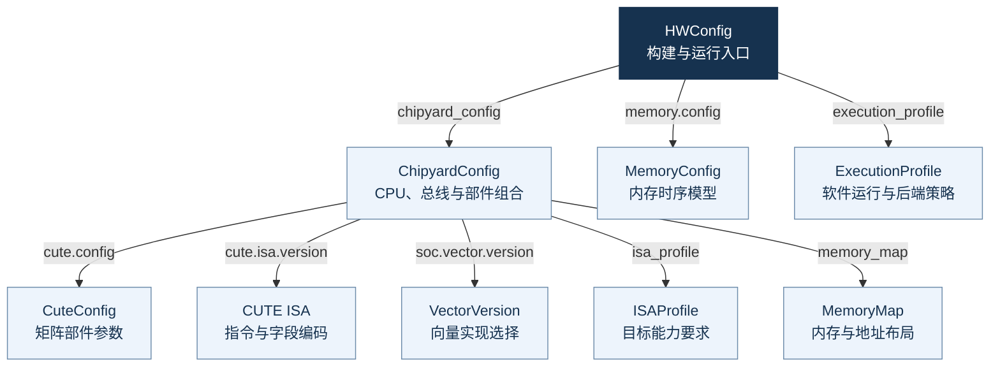

# 把愿望拆成可以完成的独立工作

“帮我把这个模型跑起来。”这句话很自然，但如果直接交给一个 agent，它马上就得
同时面对平台选择、数值规则、软件实现、编译工具和验证方法。还没开始修改代码，
就已经有太多事情需要猜。

我们先把愿望缩小一点：“在已经有的 SoC 上，让模型里的一段矩阵计算跑对。”
硬件可以复用，计算范围也明确了。接下来继续问：要证明它跑对，具体需要得到哪些结果？

## 分解SoC的构建的任务

一段计算要得到可信的结果，至少需要下面几部分：

```text
让模型里的一段矩阵计算跑对
├─ 有一个可以运行它的 SoC --> OpenCUTE
│  ├─ 选定处理器、计算部件和内存组合
│  └─ 生成硬件设计，以及能在电脑上模拟其运行的工具
├─ 有一个表达这段计算的程序 --> CUTE-SDK
│  ├─ 确定输入数据，以及这些数据怎样存放和计算
│  └─ 编写程序，说明计算分几步、每步会产生什么结果
├─ 知道正确结果应该是什么 --> CUTE-Trace
│  ├─ 按相同规则，用独立的方法算出预期结果
│  └─ 保存这些结果，作为后续比较的依据
└─ 知道硬件设计实际做对了没有 CUTE-Verify
   ├─ 模拟运行程序，记录计算过程和实际结果
   └─ 对照预期结果，检查执行顺序和运行是否完整
```

这些小愿望都能交出具体的东西：可运行的硬件模型、程序、预期结果、运行记录和检查
结论。前一部分交出什么，后一部分就据此继续工作。先把这条交接关系想清楚，再决定
由哪个工程组件承担。

## 分解构建任务到什么程度？

可以用一个简单的判断：**接手的 agent 是否已经知道从哪里开始、允许改什么、最后
拿什么证明完成？** 如果还需要重新决定整个系统架构，这个任务通常还可以继续拆。

例如，“确认这段计算是对的”仍然包含好几件事。我们可以先固定一组输入，交付
“这组输入应该得到什么答案”；再让硬件设计执行同样的计算，交付“它实际算出了什么”；
最后逐项比较，并检查程序有没有完整执行。

| 小任务 | 开始前需要知道什么 | 完成时交出什么 |
|---|---|---|
| 算出预期答案 | 输入是什么，采用什么计算规则 | 一组可以逐项核对的预期结果 |
| 让设计执行这段计算 | 硬件能执行哪些操作，输入放在哪里 | 可运行的程序，以及每一步应产生的结果说明 |
| 记录实际执行情况 | 哪些结果需要观察，怎样判断计算完成 | 实际结果和对应的运行过程记录 |
| 判断本次运行是否正确 | 预期结果、实际记录和比较规则 | 通过结论，或具体到某一步、某个结果的错误说明 |

交给 agent 时，可以明确地说：“输入和计算规则已经确定，这次只负责算出预期答案，
并提供几个容易检查的例子。”接手者就知道自己的工作从哪里开始、到哪里结束。

因此，任务大小更适合按“还有多少决定没做”衡量。只改一行代码，也可能需要重新决定
整套计算规则；要修改几个文件，但输入、交付和验收都已明确，反而可以是一个边界清楚
的小任务。实际操作见 [上手小实验](demo/index.md) 和 [BERT 实践](practice.md)。

## 何时可以并行地启动任务？

输入输出和计算规则已经固定时，一个 agent 可以编写运行程序，一个实现硬件中的
计算过程，另一个独立计算预期答案。这些工作有了共同前提，就可以发挥“身外化身”
的作用，各自推进，再把交付接起来检查。

如果连“什么时候算任务完成”都还没确定，就要先解决这个问题。
以当前计算方式为例，程序提交计算请求后，硬件还需要时间执行。程序必须确认计算
完成，才能让下一步使用结果。如果一边把“请求已提交”当成完成，另一边认为必须等到
“结果已写好”，接起来就可能读到尚未算完的数据。
这类交接规则要先敲定，再交给多个 agent 分别实现。

所以拆任务时，同时写明依赖：哪些 Truth 已经固定，当前任务会交出什么，谁会继续
使用它。所有小任务最终要回到同一个系统目标上验收。

## 用 HWConfig 统筹构建目标!

而这需要一套自上而下的任务管理方式：先确定要交付的系统，再展开它需要的部件、
各环节的输入输出，以及任务之间的依赖。

在 OpenCUTE 中，我们以 **HWConfig 统筹构建目标**：它引用硬件组合、内存仿真设置和执行策略；硬件组合再继续
引用具体部件与能力要求。

构建工具沿着这条关系找到要生成的内容，参与开发的 agent 也从同一个目标出发。
负责程序的任务据此了解硬件条件，负责硬件的任务知道自己要提供哪些能力，负责验证
的任务则核对运行和产物是否属于这套目标。每个小任务都能说明自己服务于哪次构建。


HWConfig 固定构建目标与配置依赖，具体开发任务的分工、进度和验收由围绕该目标的
人和 agent 维护。新增能力时，先找到它影响的配置与部件，再拆出实现任务，最后把
结果放回这套目标中检查。这样，分头完成的小愿望才能逐步合成最初的大愿望。




下一章介绍 [OpenCUTE 的各个子项目怎样承接这些职责](modules.md)，随后再用
[配置依赖图](config-architecture.md) 展开 HWConfig 与下层对象的关系。
