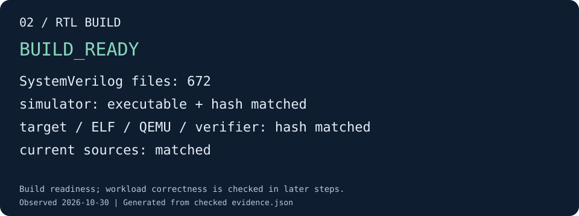

# 02 · 编译 RTL 与运行程序

本步把 HWConfig 变成可执行的系统实验。先从硬件生成 SystemVerilog 和 DTS，再依据
实际硬件能力生成 SDK 目标包，构建双 ELF、QEMU、verifier 与 Verilator simulator。

## 执行构建

继续使用第 01 步的终端和 `BUILD_DIR`：

```sh
python3 tools/runner/cute-system-build.py \
  --hwconfig cute4tops_shuttle512_d512_v512_m512_sysbus512_membus1_core_dramsim48 \
  --out "${BUILD_DIR:?请先完成第 01 步}" \
  --cc "$(command -v riscv-none-elf-gcc)" --jobs 16
```

终端按阶段打印 `BUILD ...`；详细输出写入 `$BUILD_DIR/logs/`。
首次构建需要依次完成 elaboration、软件/QEMU 编译和 Verilator 编译。成功结束时打印
`BUILD_COMPLETE` 及构建清单路径。若本机 QEMU 依赖使用独立前缀，沿用环境已配置的
pkg-config/库路径，具体参数见 [系统验证构建](../build-system.md)。

这里的“RTL 编译成功”包括两件事：硬件生成了 SystemVerilog，Verilator 又把它编译成
宿主机可执行的 simulator；只看到一个 `.sv` 文件还不足以执行后续实验。

## 核对构建产物

```sh
python3 tools/docs/demo_check.py build \
  --build-manifest "$BUILD_DIR/build-manifest.json" \
  --out "${DEMO_ROOT:?请先完成第 01 步}/02-build"
```

检查器从 manifest 找到带指纹的 RTL 目录，核对当前源码、目标包及二进制哈希，确认
simulator 可执行且存在生成的 SystemVerilog。不用手填 `rtl-FINGERPRINT` 目录名。

## 验收效果



图由本轮构建产物核对生成。[查看该图的证据](../assets/demo/02-build.json)。

| 产物 | 在哪里看 | 证明什么 |
|---|---|---|
| SystemVerilog、DTS | manifest 中 simulator 同级的 `generated-src/` | 硬件生成完成 |
| simulator、QEMU、verifier、ELF | `build-manifest.json` 的 `artifacts` | 后续工具实际使用的文件及身份 |
| SDK 目标包 | `target/` | 平台、编译与链接依据来自本次配置与硬件导出 |
| `BUILD_READY` | `$DEMO_ROOT/02-build/evidence.json` | 当前源码和构建产物匹配 |

成功标准是构建正常结束且检查器输出 `BUILD_READY`。本步未运行系统 workload；
不能把构建完成当作 RTL 数值正确。失败时按终端提示打开相应日志，优先处理第一处错误。
源码变更后重新构建，不手改 manifest 哈希。

[下一步：用 QEMU 获得 golden](golden.md)
