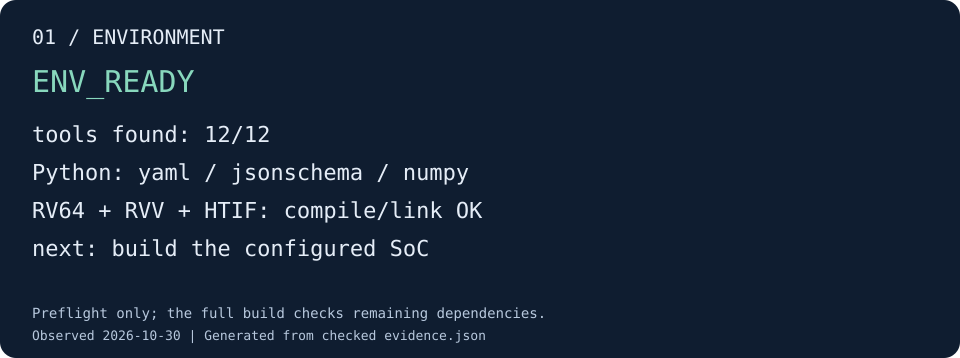

# 01 · 环境准备与预检

本步目标是确认终端能够找到构建工具，并实际编译、链接一个使用 RVV 的 HTIF 裸机
小程序。这样可以在开始耗时的 SoC 构建前，先定位工具链和 Python 依赖问题。

## 准备环境

全新 checkout 可使用仓库现有初始化入口，在 CUTE 根目录执行：

```sh
bash scripts/setup-env.sh
```

它初始化子模块并调用 Chipyard 的依赖安装流程。安装结束后，按该环境的提示激活工具；
由 Chipyard 创建环境的 checkout 使用：

```sh
source chipyard/env.sh
```

已有开发环境直接激活它，不重复运行初始化。此实验在已经准备好的本机环境上验收，
没有验证全新操作系统的从零安装。所需工具及版本范围见 [构建环境](../build-system.md)。
`riscv-none-elf-gcc` 必须位于 `PATH`，并具备 RVV、Zfh/Zvfh 与 `htif_nano.specs`；
普通 Linux 交叉编译器不能直接替代。

当前 Python 需要 PyYAML、jsonschema、NumPy。若已激活的是可管理的 Python 虚拟环境，
缺少时安装：

```sh
python3 -m pip install PyYAML jsonschema numpy
```

QEMU 构建还需要 GLib/pkg-config 等宿主机依赖；其编译和运行库必须来自匹配的环境。
预检只检查本步列出的前提，剩余依赖由下一步完整构建检查。

## 建立实验目录并检查

以下变量在后续各步继续使用。命令均从仓库根目录执行：

```sh
export DEMO_ROOT="../opencute-out/demo-$(date +%Y%m%d-%H%M%S)"
export BUILD_DIR=../opencute-out/system
python3 tools/docs/demo_check.py environment --out "$DEMO_ROOT/01-environment"
```

检查器会查找 12 个工具、三个 Python 模块及所选部件的源文件，并执行 RV64/RVV/HTIF
编译链接。`ENV_READY` 表示这些前提满足；它没有执行 RTL，也没有验证程序数值结果。

## 验收效果



图由实跑检查生成。[查看该图的证据](../assets/demo/01-environment.json)。

你的目录 `$DEMO_ROOT/01-environment/` 应包含 `toolchain-smoke.riscv`、
`toolchain.log`、`evidence.json` 和 `result.svg`。终端必须输出 `ENV_READY`，命令退出码为 0。
可以打开自己的 `result.svg` 对照上图；编译器路径和版本以你的 `evidence.json` 为准。

若失败，先看 `error.json` 列出的缺项；编译链接失败再看 `toolchain.log`。修复环境后，
重新设置 `DEMO_ROOT`，建立一轮新的检查记录。没有通过本步就不要把缺依赖当成 RTL bug。

[下一步：编译 RTL 与运行程序](build.md)
