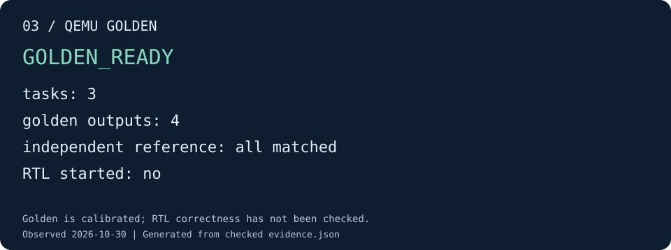

# 03 · 用 QEMU 获得 golden

本步只运行 QEMU，获得软件各任务的预期输出，并用独立 reference 校准它们。
小用例 `system_int8_128` 包含三个任务：RVV 准备输入、CUTE GEMM、RVV 消费结果。

## 生成并校准输出

```sh
python3 tools/runner/cute-system.py \
  --build-manifest "${BUILD_DIR:?请先完成第 02 步}/build-manifest.json" \
  --case-name system_int8_128 --mode offline --stop-after golden \
  --out "${DEMO_ROOT:?请先完成第 01 步}/03-golden"

python3 tools/docs/demo_check.py golden \
  --run "$DEMO_ROOT/03-golden" --out "$DEMO_ROOT/03-check"
```

runner 先检查配置、源码、ELF 和输入身份，再从 ELF 符号解析输出地址。
QEMU 遇到软件 checkpoint 时导出相应内存区域；runner 将每个输出与独立 reference
比较，全部通过后才返回 `GOLDEN_READY`。此停止点不启动 RTL，也不生成正确性 `PASS` 报告。

## 验收效果



图由实跑任务清单核对生成。[查看该图的证据](../assets/demo/03-golden.json)。

| 输出文件 | 对应结果 |
|---|---|
| `golden/0-1-sys_a.bin`、`golden/0-1-sys_b.bin` | 第一个任务准备的两个输入矩阵 |
| `golden/0-2-sys_c.bin` | CUTE GEMM 输出 |
| `golden/0-3-sys_v.bin` | RVV 消费后的输出 |

这些文件位于 `$DEMO_ROOT/03-golden/`。`task-manifest.json` 记录每个输出的字节数、
地址、哈希和 `oracle_calibration.passed`；`qemu-command.json` 保存实际启动命令。
验收时要求四个输出完整、哈希匹配、校准全部为 true。

`stage-report.json` 的 `correctness_verified: false` 是正常结果：本步只建立预期值，
还没有判断 RTL。若校准失败，查看 `qemu.log` 和首个失败的输出；此时不能进入
“RTL 是否正确”的比较，更不能用 RTL 输出反过来修补 golden。

[下一步：让 RTL 产生 trace](trace.md)
