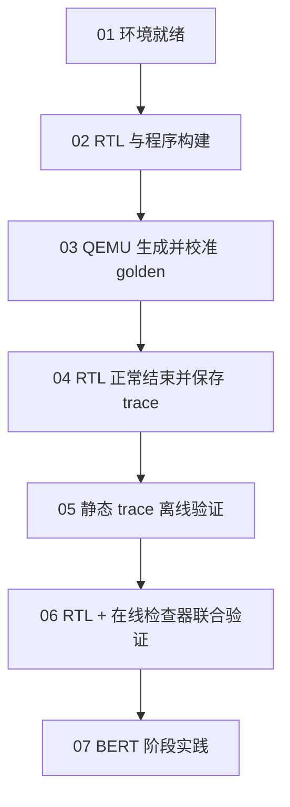

# 上手 demo

先用一个小用例看懂整条验证链，再进入 BERT 阶段。每一步都给出命令、产物、通过标准
和实际验收效果图；你也可以用同一检查命令生成自己的验收卡片。

## 六个小实验，再进入 BERT

| 步骤 | 本步结束时得到什么 | 验收状态 |
|---|---|---|
| [01 环境准备与预检](environment.md) | 工具可用，RV64/RVV/HTIF 小程序可编译链接 | `ENV_READY` |
| [02 编译 RTL 与运行程序](build.md) | SystemVerilog、simulator、双 ELF、QEMU、目标包和 manifest | `BUILD_READY` |
| [03 用 QEMU 获得 golden](golden.md) | 每个任务的输出，全部经过独立 reference 校准 | `GOLDEN_READY` |
| [04 让 RTL 产生 trace](trace.md) | 正常退出的 RTL、完整保存的 trace 和初态/golden | `TRACE_READY` |
| [05 验证静态 trace](offline.md) | 对已有日志的独立离线验证报告 | `PASS` |
| [06 在线联合检查](online.md) | RTL 运行同时检查，最终在线/离线报告一致 | `PASS` |
| [07 BERT 阶段实践](../practice.md) | 把同一流程用于 Q/K/V 投影、量化与转置 | 7 个 checkpoint 通过 |

[从环境准备开始](environment.md){ .md-button .md-button--primary }
[已有系统基线，进入 BERT](../practice.md){ .md-button }

前六步使用 `system_int8_128`：RVV 准备输入 → CUTE INT8 GEMM → RVV 消费结果，
共三个任务。它比模型阶段小，适合先分清 golden、trace、checker 各自的作用。
`*_READY` 只表示该阶段的产物就绪，RTL 正确性要到验证报告 `PASS` 才能判断。

## 怎样跟着做

命令均在 CUTE 仓库根目录、同一个已激活工具环境的终端执行。第 01 步建立本次实验目录，
后续都使用它；重新开始一轮时建立新的目录，不覆盖已有记录。路径统一位于
`../opencute-out/`，无需手填机器绝对路径。

第 03 步只运行 QEMU；第 04 步为自己的运行包重新生成和校准 golden，再运行 RTL。
第 05 步只分析已保存的日志；第 06 步进行一次新的在线运行，不复用离线 PASS。

页面中的图是 **2026-10-30 实跑结果生成的验收卡片**，每张图旁有 JSON 证据链接，
不是模拟的终端截图，也不代替你自己的验收。工具环境安装与全新机器初始化仍受
本机依赖条件影响；第 01 步明确区分初始化、环境激活和预检。

需要理解系统选择时阅读 [配置实践](../practice-config.md) 和
[Config-first 对象与依赖](../config-architecture.md)；操作和接口细节集中在
[工程组件](../engineering/index.md)。
