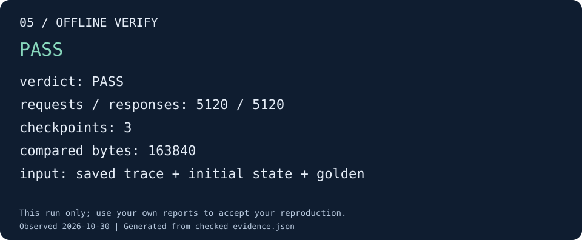

# 05 · 验证静态 trace

本步对第 04 步保存的日志做独立离线回放。它读取 trace、初态和 golden，重建内存状态，
检查请求/响应配对、任务完成顺序和每个输出，不重新运行 QEMU 或 RTL。

## 执行独立回放

```sh
python3 tools/runner/cute-system-replay.py \
  --run "${DEMO_ROOT:?请先完成第 04 步}/04-trace" \
  --verifier "${BUILD_DIR:?请先完成第 02 步}/build/verify/cute-system-verify" \
  --out "$DEMO_ROOT/05-offline" --timeout 600

python3 tools/docs/demo_check.py offline \
  --run "$DEMO_ROOT/05-offline" --out "$DEMO_ROOT/05-check"
```

回放入口核对正常退出记录及 verifier 身份，保留本次使用的 trace、初态和 golden 哈希。
验证器仍要求完整的任务与结束条件；仅有成功 footer 不足以得到 PASS。

## 验收效果



图由本次独立回放报告核对生成。[查看该图的证据](../assets/demo/05-offline.json)。

本例应比较三个 checkpoint 的全部输出，共 163840 字节。示例运行配对了 5120 组
请求/响应。不要只对照计数：最终必须是命令退出码 0、`report.json` 的 `verdict: PASS`，
且没有早停。`provenance.json` 说明本次回放消费了哪一组文件。

由于第 04 步没有在线 checker，报告中的 `online_offline_equal: false` 表示没有可比较的
在线报告，并不表示数值失败。在线与离线一致性留到下一步实际执行。

如果结果为 FAIL，先看 `detail` 定位首个协议或数值错误；TIMEOUT/ERROR 表示未完成或
输入不满足条件。结果目录与原 trace 保持独立，不覆盖原始记录。

[下一步：在线联合检查](online.md)
