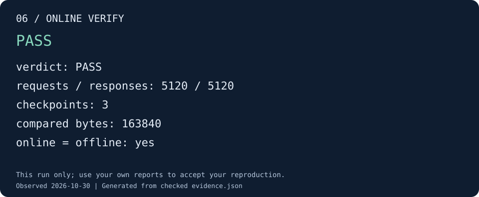

# 06 · RTL 与在线检查器联合运行

本步重新启动一次系统运行：QEMU 生成并校准预期值，RTL 执行时，在线 checker 持续
消费新增 trace。错误一旦被发现，runner 可以停止本次 RTL 进程；正常结束后再用
同一 checker 独立回放完整日志，核对两份报告。

## 启动联合检查

```sh
python3 tools/runner/cute-system.py \
  --build-manifest "${BUILD_DIR:?请先完成第 02 步}/build-manifest.json" \
  --case-name system_int8_128 --mode online --poll-seconds 0.2 \
  --out "${DEMO_ROOT:?请先完成第 01 步}/06-online"

python3 tools/docs/demo_check.py online \
  --run "$DEMO_ROOT/06-online" --out "$DEMO_ROOT/06-check"
```

这里不使用 `--stop-after`，完整执行到验证结束。轮询间隔影响在线发现错误的延迟，
不改变硬件同步或 checker 的判断规则；本例很小，通常很快结束，未必有时间观察中间屏幕。
完整的执行与检查结果都会保存。

## 验收效果



图由本次在线运行的报告核对生成。[查看该图的证据](../assets/demo/06-online.json)。

验收需要同时满足：

- `rtl-result.json`：RTL 和在线 checker 的退出码均为 0，`early_stop` 为 false。
- `report.json`：`verdict` 为 PASS，`online_offline_equal` 为 true。
- `online-report.json` 与 `offline-report.json` 内容相同，任务、输出和结束条件完整。

请求/响应数量相等本身不能证明数据正确；在线与离线相同也不能单独证明通过，两份
报告都为 FAIL 同样可以相等。这里检查的是正常完成、PASS 和报告一致三项同时成立。

## 下一步把小实验用到 BERT

现在已经分别观察了环境、构建、golden、trace、离线验证和在线联合检查。
继续 [BERT 阶段实践](../practice.md)：复用本次系统构建，生成 quick 模型输入和程序，
将三个系统 checkpoint 扩展为 Q/K/V 累加、量化、转置的七个 checkpoint。

若希望检查 TCM 或延迟场景，使用 [运行说明](../running.md) 中对应的 case 和参数，
每次建立新输出目录。新配置和新软件仍需各自的验收记录。
