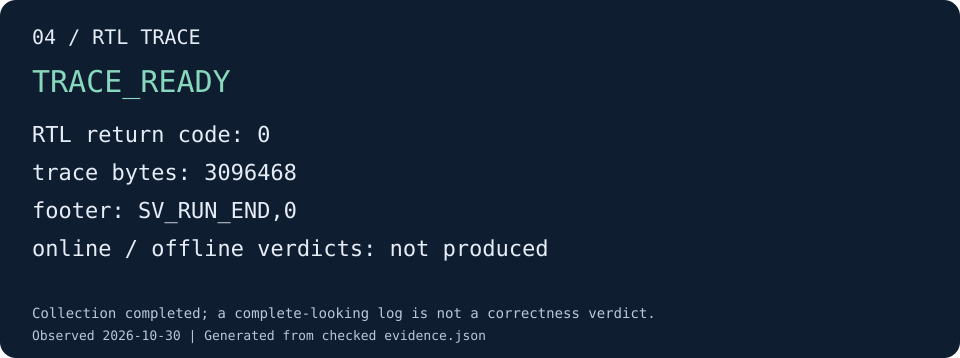

# 04 · 让 RTL 产生 trace

本步让同一个用例在 RTL simulator 上执行，收集完整的结构化 trace。
这次采用离线收集模式，既不启动在线 checker，也不立即执行离线验证。

## 运行到 trace 收集完成

```sh
python3 tools/runner/cute-system.py \
  --build-manifest "${BUILD_DIR:?请先完成第 02 步}/build-manifest.json" \
  --case-name system_int8_128 --mode offline --stop-after trace \
  --out "${DEMO_ROOT:?请先完成第 01 步}/04-trace"

python3 tools/docs/demo_check.py trace \
  --run "$DEMO_ROOT/04-trace" --out "$DEMO_ROOT/04-check"
```

每个运行目录都保存自己的输入、golden 和来源记录。因此本命令会先重新执行 QEMU
并校准 golden，再执行 RTL；不用从第 03 步复制二进制输出。之后的离线验证消费
`04-trace/` 内这组匹配的产物。

## 验收效果



图由实跑 trace 与 RTL 退出记录核对生成。[查看该图的证据](../assets/demo/04-trace.json)。

查看尾部和执行状态：

```sh
tail -n 5 "$DEMO_ROOT/04-trace/trace.log"
python3 -m json.tool "$DEMO_ROOT/04-trace/rtl-result.json"
```

`trace.log` 末尾应为 `SV_RUN_END,0`；`rtl-result.json` 应有 `returncode: 0`、
`early_stop: false`、`online_returncode: null`。`stage-report.json` 为 `TRACE_READY`，
同时保留 `correctness_verified: false`。

trace 包含请求/响应、checkpoint 和周期水位，具体字段见 [Trace 协议](../trace/protocol.md)。
`verify.tsv` 将 trace 对应的初态、输出地址和 golden 交给后续 checker。
这一步只证明收集和执行正常结束；缺事件、数据错误、完成顺序错误仍需下一步检查。

若 RTL 超时或非零退出，本步不会返回 `TRACE_READY`。先查 `rtl.stdout.log`、
`trace.log` 和 `runner-error.json`；不要手补成功 footer 来继续实验。

[下一步：验证静态 trace](offline.md)
