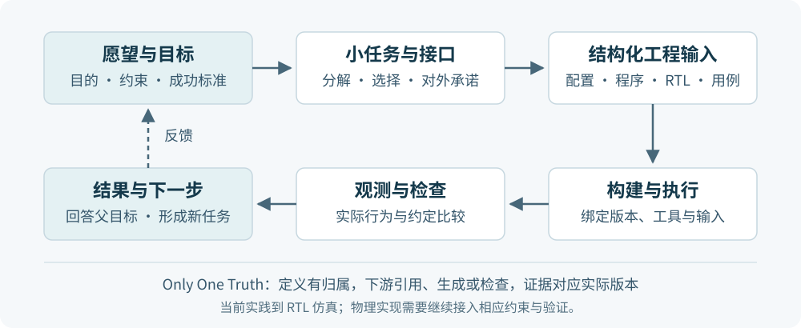

# OpenCUTE：从愿望到可以验证的 SoC

我们希望用自然语言完成 RTL SoC 的开发。
人描述希望得到什么、哪些条件必须满足，
AI 将这些愿望逐层具体化，落实为可构建、可运行、可验证的设计。

这是 OpenCUTE
所追求的 **AI 原生（AI native）开发**。

<!-- 自然语言能表达目的，硬件工具需要精确输入。两者之间需要一条持续保持含义一致的路径：
从愿望中确定目标与约束，把大目标拆成可以完成的小目标，为它们约定接口，再生成
配置、软件、RTL 和验证输入。每次实践的结果沿这条路径返回，说明愿望实现到了哪里。

 -->

## 我们怎样接近这个愿望

我们先明确一个事实，自然语言的表达存在歧义。

但只要给构建系统一个确定性的输入，构建系统就可以给出一个确定性的输出。
但是目前的构建系统非常非常复杂，他涉及操作系统、计算机体系结构、计算机组成原理、性能分析、乱序执行、数据流架构设计、缓存替换、一致性模型、互联....
假设一门知识的选择空间有10，那10门知识叠加在一起的选择空间就是，

  <math xmlns="http://www.w3.org/1998/Math/MathML" display="block" aria-label="从 i 等于 1 到 10，连乘 10，等于 10 的 10 次方">
    <mrow>
      <munderover><mo>∏</mo><mrow><mi>i</mi><mo>=</mo><mn>1</mn></mrow><mn>10</mn></munderover>
      <mn>10</mn><mo>=</mo><mn>10000000000</mn>
    </mrow>
  </math>
  😒

这让AI去全盘考虑和涉及完整的这个架构可太难了。叠加上富有歧义的自然语言表达，这让AI去给出一个确定性的输出，这搜索空间也太大了吧？
但是幸好，我们有可以借鉴的优质开源项目，这些项目的构建流程，经过工程师们的筛选与抽象，每一个阶段的交付物，输入输出的搜索空间都很小，且能稳定交付。

于是就可以将愿望的表达，拆解成一个一个的能够被处理的小愿望对象，并确定好每个对象的职责和功能，以及对象之间的接口，让AI可以在有限的空间里组合/协同。
让原本一口气完成的任务，被拆解成

  <math xmlns="http://www.w3.org/1998/Math/MathML" display="block" aria-label="从 i 等于 1 到 10，累加 10，等于 100">
    <mrow>
      <munderover><mo>∑</mo><mrow><mi>i</mi><mo>=</mo><mn>1</mn></mrow><mn>10</mn></munderover>
      <mn>10</mn><mo>=</mo><mn>100</mn>
    </mrow>
  </math>
  😁

复杂度通过分解分配给各个子项目；然后让多个subagent协作，同时让每一个agent，在尽可能确定的上下文下，完成稳定的交付。
或许就能完成这个SOC呢？

为了完成得到这个尽可能确定的上下文，贯穿其中的原则是 **Only One Truth**：每项事实都有明确的定义位置和维护责任，
其他地方引用它、由它生成，或检查是否与它一致。然后敲定这个Truth后，再让AI参与构建。

OpenCUTE就将构建系统的层层交付，依托在**CONFIG-FIRST**这个原则上。我们将SoC的生成的目标对象，全部以CONFIG指定，**CONFIG**是全局可见的唯一**Truth**，对于操作OpenCUTE的agent，我们希望他只用**CONFIG**描述，就可以完成SoC构建的全流程。

然后SOC的增量开发，则基于新增的**CONFIG**及其映射到的工程组件上，完成拆解后，再分发到各自的agent上完成开发与交付。

## 帮助理解愿望与实现方式

| 阅读阶段 | 要回答的问题 | 章节 |
|---|---|---|
| 愿望与目的 | 用自然语言开发 SoC，需要补上哪一段能力？ | [我们的愿望](vision.md) |
| 愿望与目的 | 怎样把一个大愿望变成可完成的小愿望？ | [逐层分解目标](decomposition.md) |
| 实现方式 | 每个子项目承担什么，怎样合作？ | [组件的职责与承诺](modules.md) |
| 实现方式 | 配置怎样传到硬件、SDK 和验证，改动后如何保持一致？ | [Config-first 对象与依赖](config-architecture.md) |

## 快速上手的demo，进一步深入了解的工程组件

| 入口 | 阅读内容 |
|---|---|
| OpenCUTE：从愿望到可以验证的 SoC | OpenCUTE的愿望，以及实现方式 |
| [上手 demo](demo/index.md) | 跟随 BERT 阶段实践，完成一次构建、运行与结果核对 |
| [工程组件](engineering/index.md) | 配置、构建、运行、验证，以及 SDK、Trace 和硬件设计文档 |
