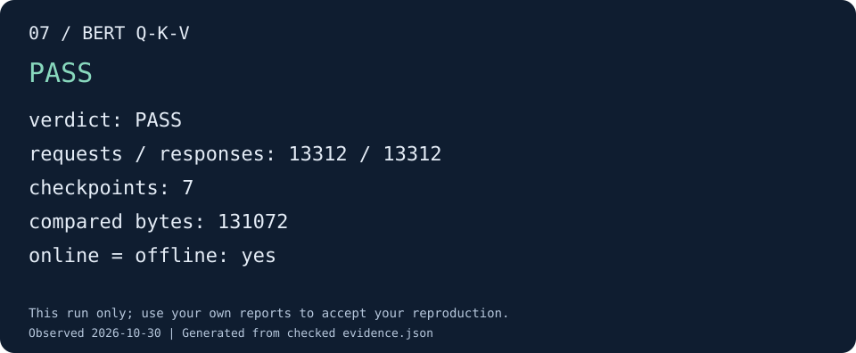

# 实践：让一个 BERT 阶段得到可信的结果

这一章用仓库已有的 `bert_1` 展示从愿望到证据的完整过程。它的意义在于：每一层
如何把问题具体化，以及各子项目如何接住上一层交付的内容。
配套的 [配置 SoC](practice-config.md) 介绍系统组合，本章继续处理计算与验证。
第一次上手建议先完成 [六个小实验](demo/index.md)，分别观察环境、RTL 构建、golden、
trace 和离线/在线验收；已完成第 02 步时，下面可以直接复用 `../opencute-out/system`。

## 1. 把愿望变成这次可以完成的目标

最初的愿望可以是：“我希望 BERT 的 Q/K/V 投影在我们的 SoC 上正确运行。”
为开始一次可判断的实践，需要明确这里的“正确”和“运行”指什么：

| 要确定的问题 | 本次选择 | 为什么这样选择 |
|---|---|---|
| 验证哪段计算 | Q/K/V 的 INT8 GEMM、饱和量化和 V 转置 | 对应已有 B1 阶段，输出边界明确 |
| 在什么系统上执行 | 已验收的单 hart Shuttle/Saturn、512-bit profile | 复用平台与观测能力，集中判断阶段行为 |
| 先用多大规模 | `quick` 的序列长度 S=64、隐藏维度 H=128 | 保留非零输入和 tile 计算，缩短反馈时间 |
| 什么算成功 | 全部声明输出符合 reference / golden，任务和日志完整 | 数值、交接与结束条件同时得到检查 |
| 结果能支持什么 | 该输入、形状和平台的阶段正确性 | 为原始形状及后续组合提供基础 |

“训练模型精度”和“更高性能”还需要各自的输入与指标，应作为后续明确的目标。
选择 quick 只是本次缩小问题的方法；原始形状需要分别验收。

## 2. 将目标交给有权威来源的工程输入

| 需要的事实 | 当前来源 | 下游如何使用 |
|---|---|---|
| 硬件组合 | `configs/chipyard_configs/cute4tops_shuttle512_d512_v512_m512_sysbus512_membus1_core.yaml` | 提供平台对应的 CPU、RVV、总线及加速器配置 |
| 系统验证的实际平台 | 构建目录生成的 `target/platform.json`、`target/facts.json` | 从同次 DTS 和执行配置派生 ISA、内存视图及观测端口 |
| 阶段、形状、输入和预期计算 | `cute-sdk/tests/models/generate.py` | 生成程序数据、case、reference 和 fixture 哈希 |
| 阶段实现 | `cute-sdk/tests/models/model.c` 与 SDK 数值核 | 编译同源的 QEMU / Verilator ELF |
| 事件定义 | `trace/catalogs/cute_trace.json` | 让 RTL 发出端和验证消费端共享事件编码 |

本例选择已验收的 HWConfig。system builder 先核对实际 DTS 与配置声明，再生成 SDK
目标包；模型构建按自身 requires 生成对应目标包。配置组合仍需满足软件和后端能力，
见 [配置链路](config-contracts.md)。生成的 `platform.json` 无需手工维护。

模型生成结果放在构建目录中。调整输入或输出时，应改生成规则并重新构建，保留原
fixture 及报告身份；运行目录里的生成文件不作为另一个独立定义来维护。

## 3. 各组件对这次任务作出什么承诺

SDK 把 B1 拆成七个运行时任务：Q 累加、Q 量化、K 累加、K 量化、V 累加、V 量化、
V 转置。这里的一次开发目标包含七个软件 checkpoint。

| 输出 | 表达的含义 | 为什么需要保留 |
|---|---|---|
| `q_acc`、`k_acc`、`v_acc` | INT32 原始累加结果 | 直接检查 GEMM，避免错误被饱和操作掩盖 |
| `q_out`、`k_out`、`v_out` | 饱和后的 INT8 输出 | 检查后处理与数据格式 |
| `v_transpose` | 转置后的 V | 检查交给后续阶段的数据布局 |

SDK 在任务输出完成后等待相关活动并发出 checkpoint。QEMU 导出对应输出，独立
reference 校准其值；RTL 通过 trace 提供实际请求和响应，verify 在成功写 ack 后
更新实际内存，再按任务边界比较全部输出。各部分共享同一个任务含义，各自提供
不同种类的证据。

## 4. 构建并运行

从 CUTE 根目录执行。先激活 [所需工具环境](build-system.md)，Python 需要 NumPy；
路径沿用构建章节的 `../opencute-out/`，编译器从已激活环境的 `PATH` 自动查找。
已有该目录下匹配源码的 S1 构建时，可直接使用它的 manifest。
首次建立基线使用：

```sh
python3 tools/runner/cute-system-build.py \
  --out ../opencute-out/system \
  --cc "$(command -v riscv-none-elf-gcc)" --jobs 16
```

在这个基线上构建模型，再只运行 B1：

```sh
python3 tools/runner/cute-model-build.py \
  --base-build-manifest ../opencute-out/system/build-manifest.json \
  --out ../opencute-out/models/quick --profile quick \
  --cc "$(command -v riscv-none-elf-gcc)" --jobs 16
export BERT_RUN="../opencute-out/runs/bert1-$(date +%Y%m%d-%H%M%S)"
python3 tools/runner/cute-model-run.py \
  --build-manifest ../opencute-out/models/quick/build-manifest.json \
  --out "$BERT_RUN" --cases bert_1 --jobs 1
python3 tools/docs/demo_check.py bert \
  --run "$BERT_RUN/bert_1" --out "$BERT_RUN/acceptance"
```

构建目录采用独立的仓库外路径，运行目录必须不存在。模型构建复用前会核对硬件、
QEMU 源码和二进制身份，运行前也会检查产物与清单是否匹配。
参数及超时说明集中在 [构建](build-system.md#model-builds) 和
[模型运行](running.md#model-runs)；本章只展示这次目标所需的选择。

## 5. 将工程结果还原为对愿望的回答



图由 2026-10-30 的 quick B1 实跑报告生成。[查看该图的证据](assets/demo/07-bert.json)。
你自己的验收卡片位于 `$BERT_RUN/acceptance/result.svg`，原始报告仍是判断依据。

先看运行目录的 `summary.json`，再查看 `bert_1/report.json`、任务清单及运行记录。
下面几个问题应能从结果包中得到回答：

| 回到上层的问题 | 对应证据 |
|---|---|
| 跑的是我们刚才约定的阶段吗？ | case、fixture、ELF 和构建/运行 manifest |
| 预期结果的来源可靠吗？ | 独立 reference 的校准结果与 QEMU 导出记录 |
| 硬件全部输出都满足约定吗？ | 七个 checkpoint 的完整输出比较 |
| 是正常执行完成，还是只截取了一段成功日志？ | 进程退出、必选事件、水位与最终报告 |
| 复核同一份记录会得到相同结论吗？ | 在线/离线报告一致及保留的原始 trace |

当前验收包已经包含该 case 的运行证据，入口见 [状态与证据](status.md#evidence)。
本章是对这条已存在流程的说明；每次重新执行都应产生自己的报告。

输出不符时，返回最早发生分歧的数值或接口边界；日志缺失时，先恢复完整观测；源码
身份不符时，先重建匹配的产物。这些结果分别指向不同的子目标，不应统一归为“再试一次”。

## 6. 为下一个愿望留下稳定基础

阶段通过后，可以保持数值和任务契约，扩展到原始形状；也可以在明确 buffer 生命周期
之后研究调度优化。若要继续加入浮点 attention，则先补齐浮点模型和相关契约。

每一步都应说明沿用了哪些承诺、新增了什么判断、需要什么证据。这样，小愿望的成果
就能成为更大愿望的可靠前提。规划下一步时，结合 [增量任务说明](config-architecture.md#task-brief)
和 [当前进展](status.md) 确定边界。
